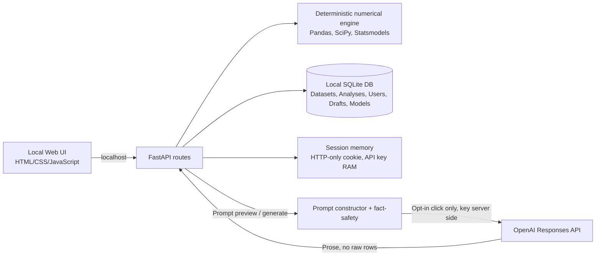

# Z-Research v0.2 — Technical design and implementation map

## Product purpose

A local prototype to support students and lecturers analyzing quantitative survey data and drafting research text with explicit source separation. **Numeric results are generated only by the deterministic Python statistical pipeline.** The AI is a secondary, optional narrative layer. Application UI must expose research unknowns rather than making up survey facts.

## Modules and UI

| Page | Input | Main action | Output |
|---|---|---|---|
| Overview | CSV/XLSX file | Upload and preview | Dataset ID, columns, N, missing counts, preview |
| Statistical Analysis | Dataset, selected variables | Descriptive/OLS/Alpha | Verified JSON and summary table |
| AI Methodology | 7 researcher-fact fields, 7 editable prompts | Generate one / Generate all | Editable academic paragraphs and saved drafts |
| AI Results | Saved analysis, user prompt | Narrative from computed stats | Results paragraphs, prompt preview and history |
| Research Model Builder | Constructs and indicators | Drag nodes, add hypotheses, save | Model JSON + SVG/PNG diagrams |
| AI Connection & Account | Username/password, API key, model, style | Local login, provider verify | Connected drafting session |

## System architecture



## Runtime design

- **Frontend**: zero-build, local static HTML/CSS/JavaScript. SVG canvas uses SVG markup with drag pointer events. Prompt customization and writing style available in the UI.
- **Backend**: FastAPI; legacy routes in `app/main.py`, v0.2 routes in `app/ai_features.py`, prompt library in `app/prompts.py`.
- **Statistical libraries**: Pandas, NumPy, SciPy, Statsmodels. No semantic result mutation by an LLM.
- **AI integration**: OpenAI Responses API, `POST /v1/responses`, `store:false`, `model` configurable. The owner passes API key to FastAPI over loopback; FastAPI calls OpenAI server-to-server using HTTPS. No raw data rows sent.
- **Password hashing**: PBKDF2-HMAC-SHA256, per-user random salt, 350k iterations (local prototype). Session identifier random, HTTP-only Strict SameSite cookie, 8-hour TTL, RAM session store.
- **Storage**: SQLite and generated normalized CSV data under `local_data/`. v0.2 uses additive migrations.
- **Scope**: single local owner, localhost, not secure for public deployment. Existing legacy statistics/datasets endpoints remain unauthenticated; multiuser access control must be added in future.

## Core database tables

**Legacy** (preserved):

```sql
CREATE TABLE datasets (
 id TEXT PRIMARY KEY, name TEXT NOT NULL, filename TEXT NOT NULL,
 rows INTEGER NOT NULL, columns_json TEXT NOT NULL,
 created_at TEXT NOT NULL
);
CREATE TABLE analyses (
 id TEXT PRIMARY KEY, dataset_id TEXT NOT NULL,
 analysis_type TEXT NOT NULL, configuration TEXT NOT NULL,
 result TEXT NOT NULL, created_at TEXT NOT NULL,
 FOREIGN KEY(dataset_id) REFERENCES datasets(id)
);
```

**New tables** (created when v0.2 first runs):

```sql
CREATE TABLE local_users (
 id TEXT PRIMARY KEY, username TEXT UNIQUE NOT NULL,
 salt TEXT NOT NULL, password_hash TEXT NOT NULL, created_at TEXT NOT NULL
);
CREATE TABLE ai_drafts (
 id TEXT PRIMARY KEY, user_id TEXT NOT NULL, dataset_id TEXT,
 analysis_id TEXT, category TEXT NOT NULL, section TEXT NOT NULL,
 style TEXT NOT NULL, model TEXT NOT NULL, prompt TEXT NOT NULL,
 content TEXT NOT NULL, created_at TEXT NOT NULL
);
CREATE TABLE research_models (
 id TEXT PRIMARY KEY, user_id TEXT NOT NULL, dataset_id TEXT,
 name TEXT NOT NULL, model_json TEXT NOT NULL, updated_at TEXT NOT NULL
);
```

## AI policy and auditability

1. User chooses a dataset or saved statistical analysis.
2. The backend constructs a fact-bounded prompt from **database-stored computed results** and researcher-entered methodological facts.
3. The UI displays the full prompt for review before any AI call.
4. Only after authenticated user clicks Generate does the backend send the prompt to OpenAI.
5. Draft text, prompt, model name, section, style and timestamps are saved in SQLite; user can read draft history.
6. Generated text is explicitly an editable draft and is never substituted for numeric analysis output.

## Statistical roadmap (all methods staged)

| Release | Planned scope | Verification gate |
|---|---|---|
| v0.2 — delivered | Descriptive, OLS, Alpha, AI drafting, model canvas | API regression tests, mock AI test |
| v0.3 | Composite scales, effect sizes, correlation, assumption diagnostics, mediation/moderation bootstrap | Unit tests against statsmodels/R and several fixed datasets |
| v0.4 | Exploratory factor analysis, CFA + fit reporting | Validated against semopy/lavaan examples |
| v0.5 | PLS-SEM outer/inner models, HTMT, AVE/CR, bootstrap, mediation & moderation under PLS | Numerical parity audits vs SmartPLS reference results on supplied benchmark datasets |
| v0.6 | Student/lecturer roles, tenant isolation, journal template .docx output, versioned reports and approvals | Privacy, security, reproducibility, reporting QA |

PLS-SEM output and path estimates should **not** be shown until implemented and validated. Diagram objects alone do not imply statistical model estimation.

## Production prerequisites (not in MVP)

Institutional user authentication (OIDC), per-dataset permissions, encrypted API credentials, secure session persistence, HTTPS, CSRF defenses, data-retention/deletion controls, abuse protection, cost budgets, provider selection, job queues, code audit, and institution approval for external data processing.
